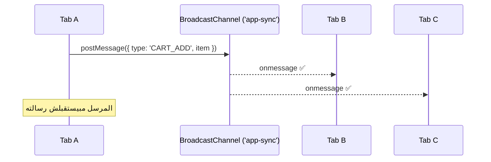

<div align="center">

# 🔄 tab-sync

**زامن الـ State بين كل الـ Browser Tabs في لحظتها — من غير Backend، ومن غير WebSockets.**

[](https://github.com/eng-kerolos-adel/tab-sync/actions)
[](./LICENSE)
[](./package.json)
[](./package.json)
[](#-تواصل-معايا)

</div>

<!-- ضيف هنا GIF للديمو:  <p align="center"></p> -->

---

<div dir="rtl">

## 📑 المحتويات

- [المشكلة](#-المشكلة)
- [الحل في 3 سطور](#-الحل-في-3-سطور)
- [إزاي بتشتغل](#-إزاي-بتشتغل)
- [جرّب الديمو](#-جرّب-الديمو-في-دقيقة)
- [التثبيت والاستخدام](#-التثبيت-والاستخدام)
- [أمثلة عملية](#-أمثلة-عملية)
- [الـ API](#-الـ-api)
- [React](#-react)
- [المقارنة مع الحلول التانية](#-مقارنة-مع-الحلول-التانية)
- [دعم المتصفحات](#-دعم-المتصفحات)
- [محاذير مهمة (الأمان)](#-محاذير-مهمة-الأمان)
- [التيستات وهيكل المشروع](#-التيستات-وهيكل-المشروع)
- [المساهمة والرخصة](#-المساهمة-والرخصة)

## 😤 المشكلة

اليوزر فاتح موقعك في أكتر من Tab، وبيحصل واحد من السيناريوهات دي:

- يعمل **Logout** في Tab، والـ Tab التانية تفضل شغالة كأن مفيش حاجة حصلت.
- يضيف منتج للـ **Cart** هنا، والصفحة التانية مش عارفة أي حاجة.
- يقلب الـ **Dark Mode** في صفحة، والباقي يفضل Light.

الحلول القديمة؟ `localStorage` events، أو `Polling`، أو WebSocket Connection كاملة لمجرد إنك تعرّف Tab بحاجة حصلت في Tab جنبها. ده كتير أوي على مشكلة بسيطة.

## ⚡ الحل في 3 سطور

المتصفح فيه API جاهزة ومتخصصة في الموضوع ده اسمها **BroadcastChannel**:

</div>

```js
const channel = new BroadcastChannel('app-sync');          // 1) افتح Channel مشتركة
channel.postMessage({ type: 'LOGOUT' });                    // 2) ابعت رسالة
channel.onmessage = (event) => console.log(event.data);    // 3) استقبلها في باقي الـ Tabs
```

<div dir="rtl">

أي Tab تبعت، **باقي** الـ Tabs المفتوحة على نفس الموقع تستقبل في نفس اللحظة. من غير API Request، ومن غير Server.

المشروع ده بياخد الفكرة دي خطوة لقدام: مكتبة صغيرة (أقل من 200 سطر، **Zero Dependencies**) بتديك:

- ✅ **رسائل** مرتبة بالنوع (`LOGOUT`, `THEME`, ...) مع Unsubscribe.
- ✅ **State متزامن** (`createSyncedState`): غيّر القيمة في Tab، تتغير في كل الباقي.
- ✅ **Tab جديد يعرف الحالة الحالية** أول ما يفتح (Handshake تلقائي).
- ✅ **حل للتعارض**: آخر كتابة هي اللي بتكسب، وكل الـ Tabs بتتجمع على نفس القيمة.
- ✅ **Fallback** للمتصفحات القديمة، وآمنة مع الـ SSR.
- ✅ **TypeScript types** جاهزة، و**تيستات** كاملة.

## 🧠 إزاي بتشتغل

</div>



<div dir="rtl">

كل الـ Tabs اللي فاتحة Channel بنفس الاسم وعلى نفس الـ Origin (نفس البروتوكول + الدومين + البورت) بتبقى على نفس "الخط". المتصفح هو اللي بيوصّل الرسائل جوه الجهاز نفسه، فمفيش Network خالص.

لشرح أعمق للـ State Sync والـ Handshake اقرا [docs/how-it-works.md](./docs/how-it-works.md).

## 🚀 جرّب الديمو في دقيقة

</div>

```bash
git clone https://github.com/eng-kerolos-adel/tab-sync.git
cd tab-sync
npm start
```

<div dir="rtl">

افتح `http://localhost:3000/demo/` وبعدين دوس على **Open another tab** (أو افتح نفس اللينك في Tab تانية). غيّر الـ Theme، ضيف منتجات للـ Cart، واعمل Sign in / Sign out، وشوف التغيير بيوصل للتاب التانية فورًا. ولوحة **Channel traffic** بتعرض كل رسالة بتعدي، ولون النقطة بيقولك مين اللي بعتها.

> ⚠️ لازم تشغّل الصفحات من Server محلي (زي `npm start`) مش بالضغط المزدوج على الملف، لأن ES Modules والـ Origin الموحد بيحتاجوا `http://`.

مثال الـ 3 سطور لوحده موجود في [examples/basic.html](./examples/basic.html) (افتحه من نفس الـ Server).

## 📦 التثبيت والاستخدام

المكتبة ملف واحد، فتقدر تنسخ [`src/tab-sync.js`](./src/tab-sync.js) على مشروعك، أو تثبتها من GitHub:

</div>

```bash
npm install github:eng-kerolos-adel/tab-sync
```

```js
import { createTabSync, createSyncedState } from 'tab-sync';

const sync = createTabSync('app-sync');

// رسائل
sync.on('LOGOUT', () => location.assign('/login'));
sync.emit('LOGOUT');

// State متزامن
const theme = createSyncedState(sync, 'theme', 'light', { persist: true });
theme.subscribe((value) => (document.documentElement.dataset.theme = value));
theme.set('dark'); // كل الـ Tabs تتحول Dark
```

<div dir="rtl">

## 🧪 أمثلة عملية

### 1) تسجيل الخروج من كل الـ Tabs

</div>

```js
const sync = createTabSync('auth');

async function logout() {
  await fetch('/api/logout', { method: 'POST', credentials: 'include' }); // الـ Backend هو اللي يقفل الـ Session
  sync.emit('LOGOUT');                                                     // وبعدين عرّف باقي الـ Tabs
  location.assign('/login');
}

sync.on('LOGOUT', () => location.assign('/login'));
```

<div dir="rtl">

### 2) Dark Mode

</div>

```js
const theme = createSyncedState(sync, 'theme', 'light', { persist: true });

const apply = (value) => (document.documentElement.dataset.theme = value);
apply(theme.get());
theme.subscribe(apply);

toggleButton.onclick = () => theme.set((current) => (current === 'dark' ? 'light' : 'dark'));
```

<div dir="rtl">

### 3) الـ Cart

</div>

```js
const cart = createSyncedState(sync, 'cart', [], { persist: true });

cart.subscribe((items) => (cartBadge.textContent = items.length));
addButton.onclick = () => cart.set((items) => [...items, product]);
```

<div dir="rtl">

## 📚 الـ API

### `createTabSync(channelName?, options?)`

بتفتح Channel وبترجّعلك Object فيه:

| العضو | الوصف |
| --- | --- |
| `tabId` | ID فريد للـ Tab الحالية |
| `supported` | `true` لو فيه وسيلة مزامنة متاحة (BroadcastChannel أو الـ Fallback) |
| `emit(type, payload?)` | يبعت رسالة لكل الـ Tabs التانية. الـ `payload` لازم يكون قابل للـ Structured Clone (مفيش Functions) |
| `on(type, handler)` | يسمع نوع رسالة معين. بيرجّع دالة `unsubscribe` |
| `onAny(handler)` | يسمع كل الرسائل (مفيد للـ Debugging) |
| `close()` | يقفل الـ Channel ويشيل كل الـ Listeners |

**Options**

| الاختيار | الافتراضي | الوصف |
| --- | --- | --- |
| `fallback` | `true` | استخدم `localStorage` events لو `BroadcastChannel` مش موجودة |
| `onSend` | — | Callback لكل رسالة خارجة (للـ Debugging) |

### `createSyncedState(sync, key, initial, options?)`

| العضو | الوصف |
| --- | --- |
| `get()` | القيمة الحالية |
| `set(valueOrUpdater)` | يغيّر القيمة هنا ويبعتها لباقي الـ Tabs. بيقبل دالة زي `set(v => v + 1)` |
| `subscribe(listener)` | بيتنادى مع كل تغيير (من هنا أو من Tab تانية). بيرجّع `unsubscribe` |
| `destroy()` | يشيل الـ Listeners بتاعة الـ State ده |

**Options:** `persist` (الافتراضي `false`): احفظ القيمة في `localStorage` عشان تفضل موجودة بعد ما كل الـ Tabs تتقفل. **متحطش فيها أسرار أبدًا.**

## ⚛️ React

فيه Hook جاهز في [examples/react](./examples/react) مبني على `useSyncExternalStore`:

</div>

```jsx
const [theme, setTheme] = useSyncedState('theme', 'light', { persist: true });
```

<div dir="rtl">

## ⚖️ مقارنة مع الحلول التانية

| | `BroadcastChannel` | `localStorage` events | `WebSocket` | `Polling` |
| --- | :---: | :---: | :---: | :---: |
| محتاج Backend | ❌ | ❌ | ✅ | ✅ |
| Network Requests | ❌ | ❌ | ✅ | ✅ |
| بيبعت Objects | ✅ | ❌ (Strings بس) | ✅ | ✅ |
| بيكتب على الـ Storage | ❌ | ✅ | ❌ | ❌ |
| سرعة الوصول | فوري | فوري تقريبًا | حسب الـ Network | حسب الـ Interval |
| بيزامن بين أجهزة مختلفة | ❌ | ❌ | ✅ | ✅ |

المقارنة دي معناها إن **BroadcastChannel هي الأنسب** لمزامنة الـ Tabs على نفس الجهاز، لكنها مش بديل لـ WebSocket لو محتاج Real-time بين أجهزة أو يوزرز مختلفين.

## 🌐 دعم المتصفحات

| المتصفح | الإصدار |
| --- | --- |
| Chrome / Edge | 54+ / 79+ |
| Firefox | 38+ |
| Safari | 15.4+ (وقبله الـ Fallback شغال) |
| Node.js | 18+ (للتيستات) |

اتأكد من الدعم الحالي على [Can I use](https://caniuse.com/broadcastchannel).

## 🔐 محاذير مهمة (الأمان)

1. **ده Sync لحالة الواجهة، مش Authentication.** المكتبة بتعرّف الـ Tabs التانية إن اليوزر عمل Logout، لكن إنهاء الـ Session الحقيقي وتأمينها لازم يحصل في الـ **Backend**. متثقش في أي رسالة جاية من الـ Channel كإثبات هوية.
2. **متبعتش Tokens أو Passwords أو بيانات حساسة** في الرسائل أو في `persist`. الرسائل بتتبعت جوه الـ Origin بس، بس أي سكريبت شغال في صفحتك (زي XSS أو Third-party Script) يقدر يقراها.
3. **اعتبر أي رسالة مدخل غير موثوق.** اتأكد من شكل الـ `payload` قبل ما تستخدمه، خصوصًا لو بتحطه في الـ DOM (استخدم `textContent` مش `innerHTML`).
4. **الرسائل مش بتتخزن.** الـ Tab اللي مقفولة وقت الإرسال مبتستلمش حاجة. عشان كده فيه Handshake للـ State لما Tab جديدة تفتح، و`persist` لو عايز القيمة تفضل بعد قفل المتصفح.
5. **الحدود:** نفس الـ Origin ونفس الـ Browser Profile بس. مفيش مزامنة بين متصفحين أو جهازين، وبعض الـ Private Windows بتعزل الـ Channel عن الـ Windows العادية.

لو لقيت ثغرة، اقرا [SECURITY.md](./SECURITY.md).

## 🧪 التيستات وهيكل المشروع

</div>

```bash
npm test      # بيشغّل node:test (محتاج Node 18+)، من غير أي Dependencies
```

```text
tab-sync/
├── src/
│   ├── tab-sync.js          # المكتبة (ملف واحد، Zero Dependencies)
│   └── tab-sync.d.ts        # TypeScript types
├── demo/                    # ديمو تفاعلي: Theme + Cart + Session + Live log
├── examples/
│   ├── basic.html           # الـ 3 سطور من الفيديو
│   └── react/               # Hook جاهز لـ React
├── test/                    # تيستات node:test
├── docs/how-it-works.md     # شرح عميق (بالعامية المصرية)
├── .github/                 # CI + Issue/PR templates
├── CHANGELOG.md
├── CONTRIBUTING.md
├── SECURITY.md
└── LICENSE
```

<div dir="rtl">

## 🤝 المساهمة والرخصة

أي مساهمة مرحّب بيها: Bug Fix، تحسين Docs، أو Feature. اقرا [CONTRIBUTING.md](./CONTRIBUTING.md) الأول.

المشروع تحت رخصة [MIT](./LICENSE). استخدمه في أي مشروع شخصي أو تجاري.

## 💬 تواصل معايا

اتعلمت حاجة جديدة؟ سيب ⭐ على الـ Repo، وتابعني على **Kero Codes** عشان اللي جاي أقوى 🚀

- YouTube: `YOUR_CHANNEL_LINK`
- Instagram: `YOUR_INSTAGRAM_LINK`
- Facebook: `YOUR_FACEBOOK_LINK`

</div>
