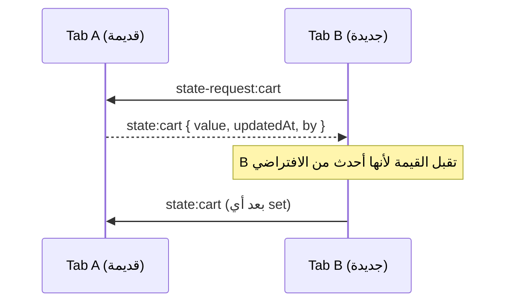

<div dir="rtl">

# إزاي `tab-sync` بتشتغل جوه

الشرح ده للي عايز يفهم اللي بيحصل ورا الكواليس، أو عايز يعدّل في المكتبة.

## 1) الطبقة الأولى: الرسائل

`createTabSync(name)` بتفتح `BroadcastChannel(name)` وبتلفّه بحاجتين:

- **Envelope** حوالين كل رسالة، عشان نقدر نفلتر ونتتبع:

</div>

```js
{ v: 1, id: '…', tabId: '…', type: 'LOGOUT', payload: null, ts: 1730000000000 }
```

<div dir="rtl">

- **الـ `v`** هي نسخة الـ Protocol، فلو غيّرنا الشكل بعدين الـ Tabs القديمة تتجاهل الرسايل الجديدة بدل ما تكسر.
- **الـ `tabId`** بيمنع أي Tab إنها تعالج رسالة بتاعتها (احتياطي، لأن BroadcastChannel أصلًا مبترجّعش الرسالة للمرسل).
- Handler واحد بيعمل Error مبيوقفش باقي الـ Handlers.

لو `BroadcastChannel` مش موجودة (Safari قبل 15.4)، بنكتب الرسالة في `localStorage` وبنمسحها على طول، فالـ `storage` event يتطلّع في باقي الـ Tabs. وفي السيرفر (SSR) كل حاجة بتتحول لـ No-op آمن.

## 2) الطبقة التانية: الـ State المتزامن

الرسائل لوحدها مش كفاية للـ State، لأن فيه 3 مشاكل:

| المشكلة | الحل |
| --- | --- |
| Tab جديدة فتحت بعد التغيير، فمعدتش حاجة | **Handshake:** أول ما الـ State يتعمل بيبعت `state-request:<key>`، وأي Tab عندها قيمة بترد بـ `state:<key>` |
| Tabين غيّروا نفس القيمة في نفس الوقت | **Last-write-wins** بالـ `updatedAt`، ولو التوقيت متساوي بنفض الاشتباك بالـ `tabId` عشان الكل يوصل لنفس القيمة |
| Tab جديدة بقيمتها الافتراضية تمسح قيمة أحدث | القيمة الافتراضية `updatedAt = 0`، فعمرها ما تكسب ومبترُدّش على الـ Handshake |

</div>



<div dir="rtl">

## 3) الـ `persist`

لو `persist: true`، كل تغيير بيتكتب كمان في `localStorage` تحت المفتاح `tab-sync:state:<key>`. ده بيحل حالة إن كل الـ Tabs اتقفلت وبعدين اليوزر رجع. القيمة المحفوظة بتشارك في نفس قواعد الـ Last-write-wins.

## 4) حدود التصميم

- المكتبة بتزامن **الواجهة**. الـ Backend هو مصدر الحقيقة للـ Auth والبيانات المهمة.
- الـ Payload لازم يعدّي Structured Clone، يعني مفيش Functions أو DOM Nodes.
- مفيش ترتيب مضمون بين رسايل Tabs مختلفة غير اللي بتوفره الـ State logic فوق.

</div>
